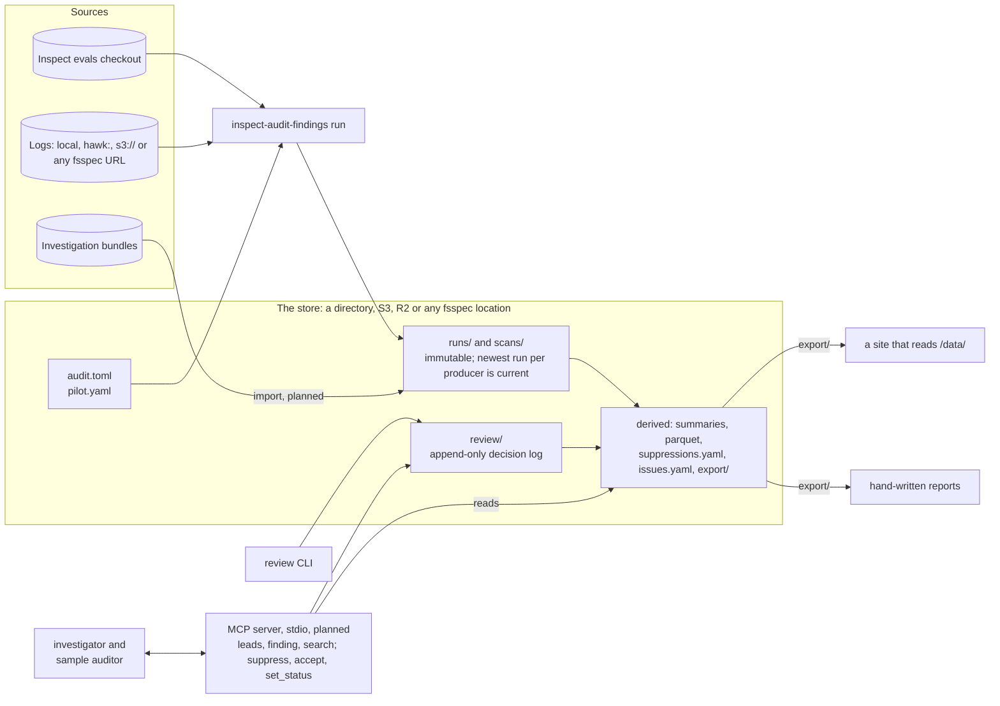

# Architecture: one store, many renderings

How the findings side of inspect_audit fits together. This is the product: what any deployment runs. Where a particular organisation keeps its store, which site shows it and which credentials it uses are deployment facts, kept out of this document and out of the package; Generality Labs' instance is described in [deployments/generality.md](deployments/generality.md) as one example.

Replaces `v1-architecture.md` (2026-10-05). Its git-repository store was superseded by the [portable store spec](superpowers/specs/2026-10-09-portable-store-design.md); its plans for lazy producer runs, hosted review actions and the measurement step are on the [roadmap](roadmap.md), not described here. Parts marked *planned* below are designed but not built.

## The shape

Everything that finds problems writes to one store. Everything that shows them reads from it. A table site, a report and an agent's leads are different renderings of the same records, not different data.

## The store

A store is named by one locator: a directory, `s3://bucket/prefix`, R2 through its S3 endpoint, or any fsspec location. Credentials come from the environment, the way an Inspect log directory finds them. The layout, the decision log and the derived files are specified in the [portable store spec](superpowers/specs/2026-10-09-portable-store-design.md); in short:

- **Runs** are immutable objects under `<slug>/runs/`, and a dataset run's scan output sits under `<slug>/scans/<run id>/`. The current view is derived, newest run per eval and producer, so concurrent writers never share a file.
- **Decisions** are an append-only log under `review/`, one object each, with author, time and reason in the record: suppress, accept, link, status, retract. A fold in time order yields the view rendering applies.
- **Derived files** (summaries, parquet, `suppressions.yaml`, `issues.yaml`, `export/`) are rewritten by every render and may be rebuilt from runs and decisions at any time.
- **Configuration** lives in the store: `audit.toml` (`[evals] profile` and `root`) and `pilot.yaml` (per-eval scan declarations). The package ships no values for either.

## How it runs

1. **Sweeps.** `inspect-audit-findings run` runs the deterministic producers over named evals: inspect-evals-lint, inspect-dataset (through each eval's task, or a declared HuggingFace dataset), and header checks against logs. Logs come from local paths, `hawk:<eval-set-id>`, or any fsspec URL, fetched into a cache. Producers write to a local work directory, the store itself when it is local, and their runs and scan directories are written or uploaded into the store. Exit 1 means a producer skipped, and the run records why; exit 2 is a usage or store error.
2. **Review.** Through the `review` CLI, never by editing files: `suppress`, `accept`, `link`, `status`, `retract`. Each writes one decision object and re-renders. A reviewer points at an eval and rule, record ids or fingerprints; the Store resolves them, refuses what the fold would refuse, and records the author.
3. **Investigations.** The investigator and sample auditor run against an eval and publish bundles (findings, assessments, coverage). *Planned:* an import that turns a bundle into runs in the store, citing it by address. What the investigator checks comes from a methodology, not from a report template; see [methodology.md](methodology.md).
4. **Leads.** An agent gets leads from the store: the `leads` command renders `LEADS.md`. *Planned:* an MCP server over stdio with a store locator, serving the same queries and accepting `suppress`, `accept` and `set_status` with the agent's run id as provenance. Hosted variants, such as an HTTP transport, are deployment concerns.
5. **Publishing.** Every render writes `export/index.json` and `export/evals/<slug>.json` into the store. What serves them is the deployment's choice: a Worker with a bucket binding, a static host with the export copied beside an app, or a report that imports the JSON it needs.

## What goes in a rendering

Everything active, with provenance as columns, nothing gated behind the investigator. The deterministic producers are the only thing that covers a whole registry cheaply; routing their output through an investigator would leave most evals empty. A rendering is honest through its columns: a lint observation reads as a lint observation, an accepted issue as accepted, an investigator-confirmed lead carries its status history. A page with no findings must be distinguishable from a page nobody checked, so every eval shows what ran, what skipped and when.

## Open decisions

- The `[tracker]` table and `promote` (accept and file an issue in one step): deferred until a deployment needs them.
- A scheduled sweep: a deployment adds one when it wants fresh data without a person running it.
- Gated approval of decisions: if wanted, a status on a decision record, not a transport.
- Targets outside the Inspect Evals registry layout: `audit.toml` reserves `[evals] profile` for them.
